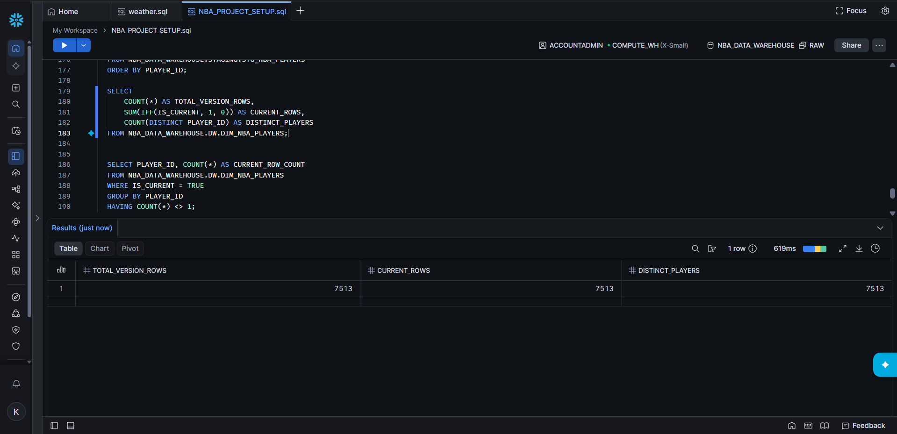

# NBA SCD2 Data Pipeline

This project extracts NBA player data from the BallDontLie API, loads it into Snowflake, and maintains player history using Slowly Changing Dimension Type 2 (SCD2).

## Architecture

```text
BallDontLie API
      |
      v
Python extraction
      |
      v
NBA_DATA_WAREHOUSE.RAW.NBA_PLAYERS_API
      |
      v
NBA_DATA_WAREHOUSE.STAGING.STG_NBA_PLAYERS
      |
      v
NBA_DATA_WAREHOUSE.DW.DIM_NBA_PLAYERS
```

- **RAW** stores source records received from the API.
- **STAGING** contains the latest record for each player.
- **DW** contains historical player versions for reporting and analysis.

## One-time Snowflake setup

Before running the Python pipeline, execute `sql/nba_project_setup.sql` in a Snowflake worksheet. It creates:

- `NBA_DATA_WAREHOUSE` database
- `RAW`, `STAGING`, and `DW` schemas
- `RAW.NBA_PLAYERS_API` table
- `DW.DIM_NBA_PLAYERS` table

The setup script also requires access to the `COMPUTE_WH` warehouse. Run the script once; the pipeline scripts can then be rerun safely.

## Project structure

```text
config/
  snowflake_config.py       # Creates the Snowflake connection
extraction/
  extract_players.py        # Retrieves players from the API
loading/
  load_players_to_snowflake.py  # Loads players into RAW
sql/
  refresh_staging.sql       # Refreshes the staging table
  scd2_transform_players.sql # Updates the SCD2 dimension
run_pipeline.py             # Runs the complete pipeline
.env                        # Local credentials; never commit
.env.example                # Credential variable template
README.md
```

## Data extracted

For every API player, the project stores:

- Player ID and name
- Position
- Team ID and name
- Jersey number
- Height and weight
- College
- Country
- Draft year, round, and number
- Extraction timestamp
- Source system

## Requirements

- Python 3.11 or newer
- Snowflake account and warehouse access
- BallDontLie API key
- Required Python packages:

```powershell
pip install requests python-dotenv snowflake-connector-python
```

## Environment setup

Create `.env` in the project root by copying `.env.example`:

```powershell
Copy-Item .env.example .env
```

Add your credentials:

```text
SNOWFLAKE_ACCOUNT=
SNOWFLAKE_USER=
SNOWFLAKE_PASSWORD=
SNOWFLAKE_ROLE=
SNOWFLAKE_WAREHOUSE=
SNOWFLAKE_DATABASE=NBA_DATA_WAREHOUSE
SNOWFLAKE_SCHEMA=RAW
BALLDONTLIE_API_KEY=
```

The `.env` file is ignored by Git and must never be committed.

## Activate the virtual environment

```powershell
Set-ExecutionPolicy -Scope Process -ExecutionPolicy RemoteSigned
.\.venv\Scripts\Activate.ps1
```

## Run the pipeline

### Test with 25 players

```powershell
python -c "from run_pipeline import run_pipeline; run_pipeline(max_players=25)"
```

### Run the complete pipeline

```powershell
python run_pipeline.py
```

The runner performs these steps:

1. Extracts player records from the API.
2. Loads records into the RAW table.
3. Refreshes the STAGING table.
4. Runs the SCD2 transformation.
5. Commits valid changes and rolls back if an error occurs.

`run_pipeline.py` is the automated orchestration script. It does not yet run automatically on a timer. Scheduling can be added later with Windows Task Scheduler or a Snowflake Task.

The RAW table is append-oriented: repeated runs add source records and preserve extraction history. STAGING contains only the latest record for each player, while the DIMENSION table retains SCD2 history.

## API pagination and throttling

The extractor uses cursor pagination with up to 100 players per request. It checks the API response for `next_cursor` until no further cursor is available.

If the API returns HTTP 429, the extractor retries the request and honors the API `Retry-After` value. A full run can take several minutes because API requests are intentionally delayed during throttling.

## SCD2 behavior

The SCD2 process calculates `HASH_DIFF` from tracked player attributes.

When a tracked attribute changes:

1. The existing current row is closed.
2. `IS_CURRENT` becomes `FALSE`.
3. `END_DATE` receives the closing date.
4. A new row is inserted with the changed attributes.
5. The new row has `IS_CURRENT = TRUE` and an open `END_DATE` of `9999-12-31`.

If a player has not changed, the existing current row is not duplicated.

## Snowflake validation

### Dimension summary

```sql
SELECT
    COUNT(*) AS TOTAL_VERSION_ROWS,
    SUM(IFF(IS_CURRENT, 1, 0)) AS CURRENT_ROWS,
    COUNT(DISTINCT PLAYER_ID) AS DISTINCT_PLAYERS
FROM NBA_DATA_WAREHOUSE.DW.DIM_NBA_PLAYERS;
```

**Validation result:**



### Exactly one current row per player

```sql
SELECT PLAYER_ID, COUNT(*) AS CURRENT_ROW_COUNT
FROM NBA_DATA_WAREHOUSE.DW.DIM_NBA_PLAYERS
WHERE IS_CURRENT = TRUE
GROUP BY PLAYER_ID
HAVING COUNT(*) <> 1;
```

No rows means the SCD2 validation passed.

### View current players

```sql
SELECT
    PLAYER_ID,
    FIRST_NAME,
    LAST_NAME,
    POSITION,
    TEAM_NAME,
    COUNTRY
FROM NBA_DATA_WAREHOUSE.DW.DIM_NBA_PLAYERS
WHERE IS_CURRENT = TRUE
ORDER BY PLAYER_ID;
```

### View one player's history

Replace `1` with another player ID:

```sql
SELECT
    PLAYER_KEY,
    PLAYER_ID,
    TEAM_NAME,
    START_DATE,
    END_DATE,
    IS_CURRENT
FROM NBA_DATA_WAREHOUSE.DW.DIM_NBA_PLAYERS
WHERE PLAYER_ID = 1
ORDER BY START_DATE, PLAYER_KEY;
```

### Check row counts

```sql
SELECT
    (SELECT COUNT(*) FROM NBA_DATA_WAREHOUSE.RAW.NBA_PLAYERS_API) AS RAW_ROWS,
    (SELECT COUNT(*) FROM NBA_DATA_WAREHOUSE.STAGING.STG_NBA_PLAYERS) AS STAGING_ROWS,
    (SELECT COUNT(*) FROM NBA_DATA_WAREHOUSE.DW.DIM_NBA_PLAYERS) AS DIMENSION_ROWS;
```

## Submission evidence

The `results/` and `docs/` folders contain evidence from the final Snowflake validation:

- `results/validation_summary.csv` — 7,513 total, current, and distinct players.
- `results/current_players.csv` — all 7,513 current player dimension records.
- `results/player_history_sample.csv` — a 25-row representative SCD2 history sample.
- `docs/validation.png` — Snowflake screenshot of the dimension summary.

These files demonstrate the final warehouse result without requiring submission of Snowflake credentials or warehouse access.

## Troubleshooting

### Missing Snowflake module

Install dependencies in the project's virtual environment:

```powershell
.\.venv\Scripts\python.exe -m pip install requests python-dotenv snowflake-connector-python
```

### API HTTP 429

Wait for the API quota to reset and run the pipeline again. The extractor retries 429 responses automatically, but repeated limits may require more waiting.

### Pipeline stops before loading

Check:

- `.env` contains all required variables.
- The API key is valid.
- Snowflake credentials and roles are valid.
- `COMPUTE_WH` and `NBA_DATA_WAREHOUSE` are available.

## Security

Credentials previously placed in `.env` or shown in terminal output must be considered exposed. Rotate the Snowflake password and BallDontLie API key, then update `.env`. The `.env` file should not be committed or shared.

## Current pipeline status

The latest full test successfully extracted and loaded 7,513 NBA players. Staging contains 7,513 latest player records, and the dimension has 7,513 current rows. Validation confirmed that no player has duplicate current records.
